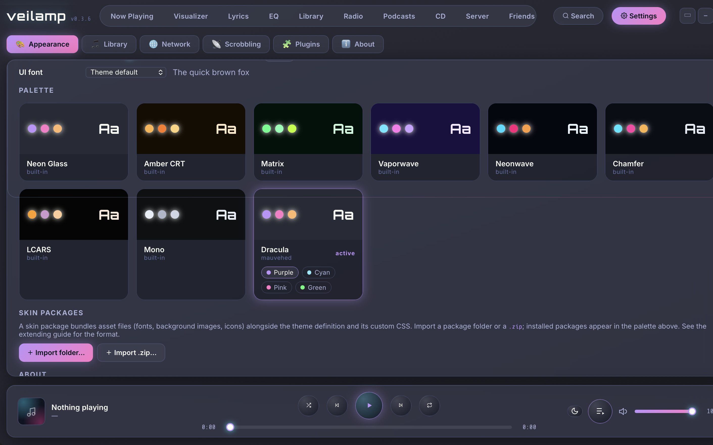

# Dracula for [Veilamp](https://veilamp.com)

> A dark theme for [Veilamp](https://veilamp.com).

## Install

All instructions can be found at [draculatheme.com/veilamp](https://draculatheme.com/veilamp).

## Team

This theme is maintained by the following person(s) and a bunch of [awesome contributors](https://github.com/dracula/veilamp/graphs/contributors).

|  |
| ------------------------------------------------------------------------------------ |
| [mauvehed](https://github.com/mauvehed)                                              |

## Community

Join thousands of vampires using Dracula Theme around the world 🦇

- [X (Twitter)](https://x.com/draculatheme) and [Instagram](https://www.instagram.com/draculatheme) - Follow for tips, news, and fun.
- [Discord](https://draculatheme.com/discord-invite) - Hang out and chat with the rest of the clan.
- [GitHub Discussions](https://github.com/dracula/dracula-theme/discussions) - Ask questions and discuss issues.

## Dracula PRO

## Theme details

This theme follows the [Dracula specification](https://spec.draculatheme.com) and maps its palette onto Veilamp's [skin variables](https://gitlab.com/wrewtopia-labs-group/veilamp/-/blob/main/docs/EXTENDING.md).

### Base colors

| Dracula      | Hex       | Veilamp variables                              | Usage                                            |
| ------------ | --------- | ---------------------------------------------- | ------------------------------------------------ |
| Background   | `#282A36` | `--bg-1`, `--app-bg`, `--on-accent`            | Mid background, window backdrop, text on accents |
| Current Line | `#44475A` | `--glass`, `::selection`                       | Glass panel fill, text selection                 |
| Foreground   | `#F8F8F2` | `--text`                                       | Primary text                                     |
| Comment      | `#6272A4` | `--text-faint`, `--glass-border`, placeholders | Faint labels, panel borders, input placeholders  |

### Accent colors

| Dracula | Hex       | Veilamp variables                                                 | Usage                                                             |
| ------- | --------- | ----------------------------------------------------------------- | ----------------------------------------------------------------- |
| Purple  | `#BD93F9` | `--cyan`, `--accent-grad`, `--glow-cyan`, `--glass-border-bright` | Primary accent, button gradients, neon glow, active panel borders |
| Pink    | `#FF79C6` | `--magenta`, `--accent-grad`, `--glow-magenta`                    | Secondary accent, gradient end, secondary glow                    |
| Orange  | `#FFB86C` | `--amber`                                                         | VU meters, warm highlights                                        |
| Yellow  | `#F1FA8C` | `--amber-bright`                                                  | VU meter peaks                                                    |
| Cyan    | `#8BE9FD` | `--cyan` / `--magenta` (variants)                                 | Primary accent in Cyan; secondary in Green                        |
| Green   | `#50FA7B` | `--cyan` (variant)                                                | Primary accent in the Green variant                               |

### Derived colors

Some Veilamp variables have no direct Dracula match. These are derived from the palette so the UI stays consistent:

| Hex       | Derived from        | Veilamp variables                         | Usage                                 |
| --------- | ------------------- | ----------------------------------------- | ------------------------------------- |
| `#21222C` | Background, darker  | `--bg-0`, `--app-bg`                      | Darkest base, backdrop gradient end   |
| `#343746` | Background, lighter | `--bg-2`, `--glass-strong`                | Raised surfaces, headers, modals      |
| `#A9B1D6` | Foreground, muted   | `--text-dim`                              | Secondary / muted text                |
| `#7B5FB0` | Purple, muted       | `--cyan-dim`                              | Dim primary accent                    |
| `#B0528A` | Pink, muted         | `--magenta-dim`                           | Dim secondary accent                  |
| `#5AA3B3` | Cyan, muted         | `--cyan-dim` / `--magenta-dim` (variants) | Dim accent in Cyan and Green variants |
| `#38AD56` | Green, muted        | `--cyan-dim` (variant)                    | Dim accent in the Green variant       |

### Variants

Veilamp themes can ship named variants that layer over the base palette. Pick one from the chips on the theme's card in the palette; the choice is remembered.

| Variant          | Primary accent   | Secondary accent |
| ---------------- | ---------------- | ---------------- |
| Purple (default) | `#BD93F9` Purple | `#FF79C6` Pink   |
| Cyan             | `#8BE9FD` Cyan   | `#BD93F9` Purple |
| Pink             | `#FF79C6` Pink   | `#BD93F9` Purple |
| Green            | `#50FA7B` Green  | `#8BE9FD` Cyan   |

Each variant also updates accent gradients, glows, dim accents, and the bright panel border, so nothing keeps the default purple when another variant is selected. Orange and Yellow stay fixed across all variants.

### Design decisions

- **Purple as primary** — Dracula Purple (`#BD93F9`) fills Veilamp's `--cyan` slot, which drives the primary accent, button gradients, and neon glow.
- **Dark text on accents** — `--on-accent` is `#282A36` (Background) because every Dracula accent is light; Veilamp's default white would be hard to read on purple or pink pills.
- **Comment for faint UI** — Comment (`#6272A4`) is used for faint captions, panel borders, and placeholders.
- **Glass tinted with Current Line** — `--glass` uses `#44475A` at 45% alpha so panels read as Dracula surfaces, not neutral gray.
- **Orange and Yellow for meters** — `--amber` / `--amber-bright` map to Orange and Yellow so VU meters stay warm in every variant.
- **Red is unused** — Veilamp has no error or danger variable, so Dracula Red (`#FF5555`) has no slot here.

## License

[MIT License](./LICENSE)
